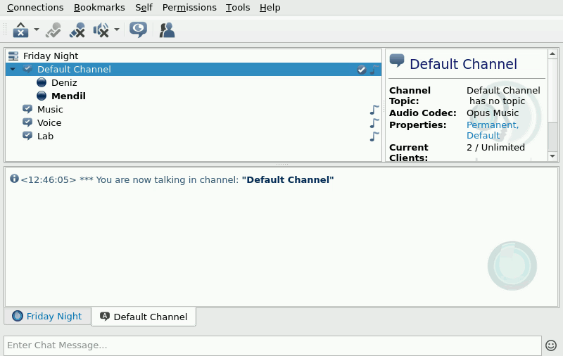

<div align="center">


# Mendil

**Song requests for your TeamSpeak server.**

Write a song in chat and Mendil plays it in your channel.

[](https://github.com/ulaski/mendil/actions/workflows/ci.yml)
[](LICENSE)
[](#requirements)
[](https://ulaski.github.io/mendil/)

</div>

<p align="center">
  
  <br><sub>Recorded in the TeamSpeak 3 client. The few seconds while the song downloads are sped up.</sub>
</p>

### Why "Mendil"?

In Türkiye, people at a *gazino* or *meyhane* used to write their song request on a *mendil*, a napkin, and pass it up to the musicians on stage. Mendil does the same for your TeamSpeak server. Write your request in chat and the band plays it. *(Pronounced men-DEEL.)*

## Features

- 🎵 Plays YouTube links, whole playlists, or the first result for a search. Spotify songs, albums and playlists work too: Mendil finds each song on YouTube.
- 📝 Has a proper queue: search and pick, play next, skip, pause, seek, move, loop, shuffle and volume, with an optional limit of songs per person
- 📻 Plays an internet radio station whenever the queue is empty, so the channel never goes quiet. A request interrupts the radio, and it comes back afterwards.
- 💤 Pauses while nobody is in its channel and carries on when someone joins
- 🔊 Keeps every track at the same loudness, so nobody has to ride the volume
- 🐳 Runs as one container. You accept the TeamSpeak license and give it your server's address.
- ⏭️ Downloads the next track while the current one plays, so songs follow each other without a gap
- 🩹 Gets back on its feet after crashes, kicks, bans and server restarts, and after a restart it continues the song where it stopped
- 🌍 Speaks English and Turkish. [Adding a language](CONTRIBUTING.md#adding-a-language) means translating one file.
- 🩺 Tells you when a channel setting makes music sound bad or keeps it from being heard, and explains YouTube blocks
- 🔐 Knows admins from listeners: listeners request songs and can skip or remove their own, admins control the rest. Set by TeamSpeak unique ID or server group.
- 🖥️ Has a web panel: see what's playing, manage the queue and add songs from your browser or phone. Friends sign in with their TeamSpeak name.
- 🧪 Comes with two voice engines: the official TeamSpeak client, or an experimental native engine that also runs on ARM and plays music in any channel

## Requirements

- A TeamSpeak 3 or TeamSpeak 6 server. Tested with TS3 server 3.13.9 and TS6 server 6.0.0-beta13.1.
- Docker with Docker Compose
- For Classic: an x86_64 (amd64) host, because the official TS3 client only exists for x86_64. ARM machines such as a Raspberry Pi or a Mac with Apple Silicon can run it under emulation, but slowly. About 300 MB of RAM per bot, and internet access on first start to download the TeamSpeak client.
- For Native: any x86_64 or ARM64 host and about 100 MB of RAM per bot.

## Quick start

No need to clone the repo. Download the compose file and the example settings:

```bash
mkdir mendil && cd mendil
curl -fsSLO https://raw.githubusercontent.com/ulaski/mendil/main/docker-compose.yml
curl -fsSL -o .env https://raw.githubusercontent.com/ulaski/mendil/main/.env.example
```

Edit `.env` and set at least:

```ini
TS3CLIENT_LICENSE=accept      # accepts the TeamSpeak client license, see "Legal" below
TS3_HOST=ts.example.com       # your server
TS3_SERVER_PASSWORD=          # if your server has one
```

Then start it:

```bash
docker compose up -d
docker compose logs -f
```

The first start downloads the TeamSpeak client (~110 MB). Once you see `connected to server`, join Mendil's channel and type `!help`.

<details>
<summary>Without Compose: a single <code>docker run</code></summary>

```bash
docker run -d --name mendil --restart unless-stopped --shm-size 256m \
  -e TS3CLIENT_LICENSE=accept \
  -e TS3_HOST=ts.example.com \
  -e TS3_SERVER_PASSWORD= \
  -v mendil-data:/home/node/.ts3client \
  -v mendil-client:/opt/ts3client \
  ghcr.io/ulaski/mendil:latest
```

Add `--platform linux/amd64` on an ARM machine.
</details>

<details>
<summary>From source</summary>

```bash
git clone https://github.com/ulaski/mendil.git
cd mendil
cp .env.example .env   # then edit it
docker compose up -d --build
```
</details>

<details>
<summary>With the native engine</summary>

In `docker-compose.yml`, use the native image and drop what only Classic needs:

```yaml
services:
  mendil:
    image: ghcr.io/ulaski/mendil:native
    container_name: mendil
    restart: unless-stopped
    env_file: .env
    volumes:
      - ts3client-data:/home/node/.ts3client

volumes:
  ts3client-data:
```

`TS3CLIENT_LICENSE` isn't needed, because no TeamSpeak client is downloaded. Everything else in `.env` stays the same; if your `.env` sets `VOICE_BACKEND=classic`, remove that line.

From source, add a `build` section to the same service, so Compose builds the native image instead of downloading it:

```yaml
    build:
      context: .
      target: native
```

and start it with `docker compose up -d --build`.
</details>

## Documentation

Everything else is on **[ulaski.github.io/mendil](https://ulaski.github.io/mendil/)**:

- [Where is your server?](https://ulaski.github.io/mendil/guides/your-server/): TeamSpeak on another machine, in Docker on the same host, or not installed yet
- [Server settings](https://ulaski.github.io/mendil/guides/server-settings/): the channel codec, talk power and anti-flood
- [Roles](https://ulaski.github.io/mendil/guides/roles/), [web panel](https://ulaski.github.io/mendil/guides/web-panel/), [radio](https://ulaski.github.io/mendil/guides/radio/)
- [Commands](https://ulaski.github.io/mendil/reference/commands/) and [configuration](https://ulaski.github.io/mendil/reference/configuration/)
- [YouTube blocks](https://ulaski.github.io/mendil/guides/youtube/), [troubleshooting](https://ulaski.github.io/mendil/help/troubleshooting/) and the [FAQ](https://ulaski.github.io/mendil/help/faq/)
- [How it works](https://ulaski.github.io/mendil/project/how-it-works/): the two voice engines, Classic and Native

The site's source is in [`site/`](site/). Changes to the docs go there.

## Development

```bash
npm ci       # the native engine's one dependency
npm test     # unit tests (Node.js 22.12+, no Docker needed)
```

See [CONTRIBUTING.md](CONTRIBUTING.md) for the end-to-end setup and [How it works](https://ulaski.github.io/mendil/project/how-it-works/) for a tour of the source.

## Legal

This project is not affiliated with or endorsed by TeamSpeak Systems GmbH. *TeamSpeak* is their trademark.

The native engine uses [teamspeak-js](https://github.com/HoneyBBQ/teamspeak-js), an independent, open-source implementation of the TeamSpeak protocol that contains no TeamSpeak code. It is not made or endorsed by TeamSpeak either. Check that third-party clients are fine with the servers you connect to.

The TeamSpeak client is proprietary and is **not** included in this repository or its Docker image. It is downloaded from TeamSpeak's servers when the container first starts, and only after you set `TS3CLIENT_LICENSE=accept`. Doing so means you accept [TeamSpeak's license terms](https://www.teamspeak.com/en/privacy-and-terms/).

You are responsible for having the right to play the content you stream, and for complying with the terms of the sites you stream from.

## License

Copyright (C) 2026 ulaski

This program is free software: you can redistribute it and/or modify it under the terms of the
[GNU General Public License](LICENSE) as published by the Free Software Foundation, either version 3
of the License, or (at your option) any later version. It comes with ABSOLUTELY NO WARRANTY.
